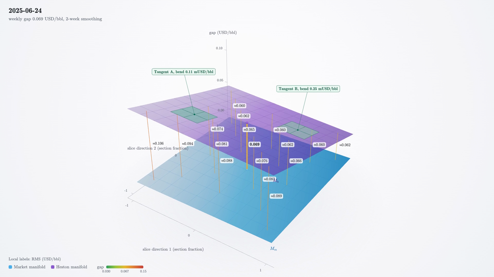

# Heston's Blind Spots in Asian Options

We study where Heston's stochastic-volatility model fails to match observed prices of CME WTI Average Price Options.

The study covers 2022–2025, using weekly snapshots on a common strike–maturity grid. At each snapshot, we estimate a local market surface from the preceding 120 trading days using PCA and a regularized quadratic fit. We then fit Heston's five parameters directly with C++ Monte Carlo and measure the distance from the projected market price vector to the fitted Heston price vector. Independent simulations with more paths check pricing accuracy.

The licensed settlement data stays outside Git. Missing prices are not imputed.

Projected local slices: Heston in purple, the market model in blue. Lines show price differences; green patches show local tangent planes on Heston's slice. The blue surface represents prices modeled from market data, not the quotes themselves.

[Methodology](docs/market_manifold.md) · [Configuration](configs/weekly_cpp.json) · [Running the code](docs/weekly_cpp_runbook.md)
